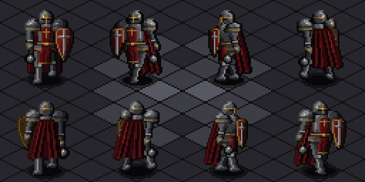
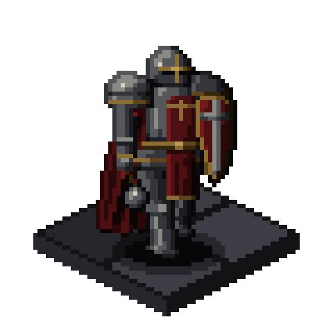
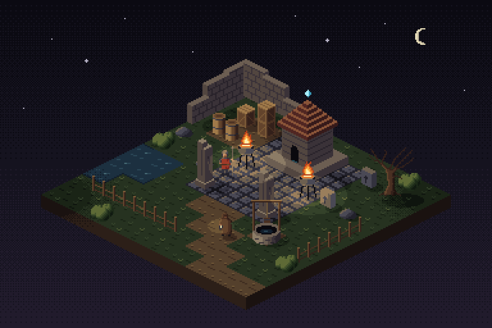
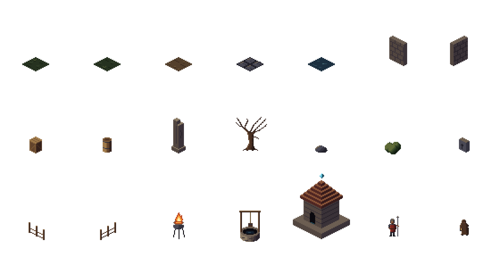
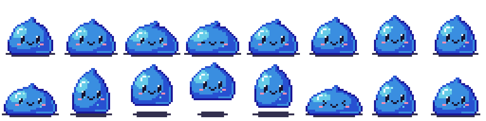
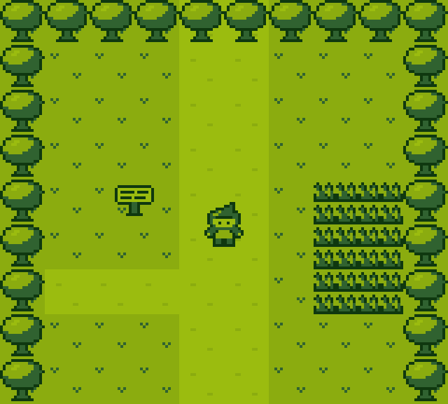
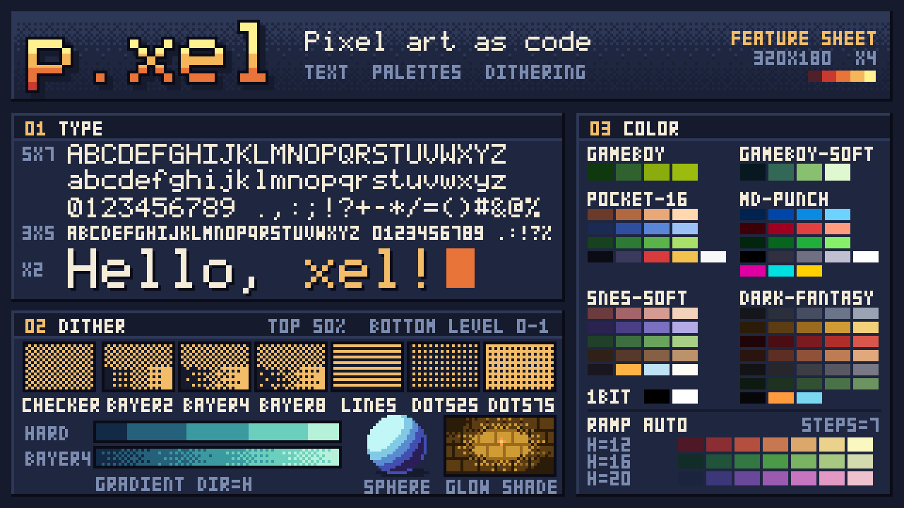

# p.xel

**Pixel-art graphics as code.** `xel.js` deterministically compiles `.xel` scripts,
a small language made for pixel art, into PNG images, animated GIFs and sprite
sheets, and into text previews that a language model can actually read.

```xel
# slime.xel
canvas 32x32
light tl
ramp goo auto base=#4fb04a steps=5 hue=16

sphere 16 19 10 ramp=goo
outline selout
```

```bash
node xel.js slime.xel --ascii            # look at it as text
node xel.js slime.xel --lint             # check it against pixel-art craft rules
node xel.js slime.xel --png slime.png --scale 8
```

No dependencies. Node 18+.

## Why a language for pixel art?

Language models are good at writing code and bad at placing pixels blind. Asking an
agent to draw with a general purpose language (Python + PIL, SVG, canvas JS) fills its
context with plumbing that has nothing to do with art, and gives it no feedback about
what it drew. p.xel turns that around:

- **Pixel-art vocabulary, nothing else.** Ramps, dithering, selective outlines,
  lit spheres and cylinders, isometric tiles and blocks, bitmap text, mirroring,
  frames and tags. One line per idea.
- **Characters as pixels.** `art` blocks let the model draw with characters, and the
  ascii preview prints the result back in the *same* characters. The model reads
  exactly what it wrote, then fixes it.
- **Eyes for the blind.** Three preview modes: `palette` (what is where), `mask`
  (silhouette test), `value` (squint test for light and shadow).
- **A linter for craft.** Orphan pixels, banding seams, palette bloat, low contrast,
  identical frames and jittering anchors are reported with coordinates.
- **Guardrails built in.** Correctly lit volumes instead of pillow shading,
  hue-shifted auto ramps instead of muddy value ramps, `part`s with offsets so
  animation frames cannot drift, `mirror` for symmetric shapes.
- **Deterministic.** Same file, same pixels. Iteration converges instead of rolling dice.

## What is in the box

| folder | content |
| --- | --- |
| [`xel.js`](xel.js), [`src/`](src/) | the compiler: parser, interpreter, rasterizers, PNG/GIF encoders, ascii, lint |
| [`docs/`](docs/) | [language reference](docs/language.md), [CLI](docs/cli.md), [engine internals](docs/engine.md) |
| [`ai/`](ai/) | the entry point for agents: rules, workflows, quality gates, style presets, templates |
| [`knowledge/`](knowledge/) | the research behind it: fundamentals, color, shading, animation, isometric, hardware styles, AI failure modes |
| [`examples/`](examples/) | finished pieces, each made by a fresh agent that only read `ai/` (see below) |
| [`test/`](test/) | regression suite (`node test/run.js`) |

## Quick tour of the language

```xel
canvas 64x40
light tl
palette dark-fantasy                         # builtin ramps: steel gold blood ...
ramp leaf auto base=#4f7a3a steps=5 hue=14   # or generate your own, hue shifted

map                                          # characters for art blocks
  o void
  s steel.2
  S steel.3
end

part gem x y                                 # reusable part with parameters
  art $x $y                                  # draw with characters
    .ooo.
    osSso
    .ooo.
  end
end
draw gem 4 4
draw gem 12 4

sphere 44 14 9 ramp=leaf                     # lit volume, no pillow shading
outline selout                               # selective outline from the ramps
dither 0 30 64 10 stone.1 stone.2 pattern=bayer4 level=0.5
text 2 32 "HP 99" gold.4 font=3x5

frame blink dur=120 from=prev                # animation: copy the frame, change it
  glow 44 14 6 steps=1
end
tag shine 0 1
export gif tour.gif tag=shine scale=4
```

Full reference: [docs/language.md](docs/language.md).

## The agent loop

```
plan header -> one pass -> xel --ascii / --ascii mask / --ascii value -> xel --lint -> fix -> next pass
```

Point a small local model at [`ai/README.md`](ai/README.md). It explains the ten rules,
the loop, eight quality gates (silhouette, value, palette, clean, light, motion, style,
files) and links the workflows for sprites, animations, isometric scenes and UI.

## Examples

Every example was drawn by a fresh agent that was only pointed at [`ai/`](ai/), then
reviewed, its feedback folded back into the language, and re-exported. Sources sit next
to the images; rebuild any of them with `node xel.js <file.xel> --out <folder>`.

### Paladin: isometric dark fantasy ARPG

Heavy armored paladin, 64x64 frames, 8 directions (5 drawn, 3 mirrored and relit),
8-frame walk and 5-frame idle per direction, 104 frames driven by one shared pose table.





Walk and idle sheets (one row per direction):
[walk-sheet.png](examples/paladin/walk-sheet.png), [idle-sheet.png](examples/paladin/idle-sheet.png),
plus `walk-<dir>.gif` and `idle-<dir>.gif` for each direction.
Source: [paladin-parts.xel](examples/paladin/paladin-parts.xel), [paladin.xel](examples/paladin/paladin.xel).

### Isometric demo scene and asset sheet

A ruined shrine at dusk on 32x16 tiles: walls, crates, barrels, a well, braziers with
torch light, a dead tree, fences, a shrine, two villagers. 21 assets shared by the scene
and the sheet through one parts file.





Animated torch flicker: [scene.gif](examples/iso-scene/scene.gif).
Source: [palette-and-parts.xel](examples/iso-scene/palette-and-parts.xel), [scene.xel](examples/iso-scene/scene.xel), [assets.xel](examples/iso-scene/assets.xel).

### Slime enemy, 32x32

Cute gel slime with an 8-frame breathing idle and an 8-frame hop (anticipation,
stretch, apex hang, impact squash, settle).

 



Source: [slime.xel](examples/slime/slime.xel).

### Hooded hero, 16x16 Game Boy overworld

Four DMG shades only, 4 directions with the classic overworld walk, and a 160x144
screen mock-up to prove it reads on a real map.

   



Source: [hero.xel](examples/gb-hero/hero.xel), [scene.xel](examples/gb-hero/scene.xel).

### Feature sheet: text, palettes, dithering

Both bitmap fonts, every builtin palette, auto-generated hue-shifted ramps, all dither
patterns, a dithered vs banded gradient, a lit sphere and ramp-based torch lighting.



Animated variant with a title shine: [showcase.gif](examples/showcase/showcase.gif).
Source: [showcase.xel](examples/showcase/showcase.xel).

### What the agents taught the language

Each example run ended with a list of problems. Most of them are now features:
even-width ellipses (`ovalbox`), seamless multi-tile blocks and thin walls
(`isobox w= d=`), cast shadows (`isoshadow`), exact 2:1 lines (`isoline`), round iso
cylinders, `glow`/`shade` ramp lighting, `rim` relighting for mirrored sprites,
`only ramp` / `only touching` masks, part defaults, frames generated in loops, dynamic
part names (`draw torso_$dir`), comparisons and `if()` in expressions, palette prefixes,
`include`, tag-per-row sheets, `--crop`, a warm-light/cool-shadow auto ramp with even
value steps, a quieter linter (8-neighbour orphans, dither detection, per tag motion and
loop-seam checks, body-bob check) and errors instead of hangs on bad numbers.

## Install as a pi skill

```bash
./install.sh
```

Copies [`SKILL.md`](SKILL.md), the compiler, `ai/`, `docs/`, `knowledge/` and
`examples/` into `~/.pi/agent/skills/p-xel/`. Everything lives in that one directory;
the skill makes pi use p.xel whenever a request involves pixel art. Run it again to
update, set `PI_AGENT_DIR` to install elsewhere.
